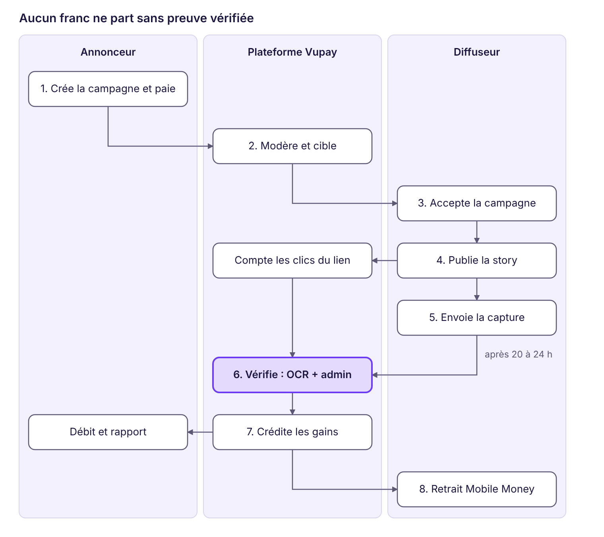

# Vupay

Vupay est une application qui paie par vue.

Plateforme publicitaire : des marques (annonceurs) paient pour que des particuliers (diffuseurs)
publient leurs pubs sur leur **statut WhatsApp** et leurs **stories** Instagram, Facebook, TikTok,
Snapchat et Telegram. Le diffuseur est payé **à la vue et au clic validés** et retire ses gains en
**Mobile Money** dans les 8 pays de l'UEMOA.

> Vupay est une plateforme publicitaire, pas un service de paiement. Marque, design et code propres :
> aucune reprise du nom, des couleurs, du logo ou des visuels de WhatsPay ni des réseaux sociaux.

- Cahier des charges : [`docs/CAHIER_DES_CHARGES.md`](docs/CAHIER_DES_CHARGES.md)
  (référence en ligne : https://claude.ai/code/artifact/88ea2633-767a-4d80-9876-02c6f3c32a76)
- Architecture : [`docs/ARCHITECTURE.md`](docs/ARCHITECTURE.md)
- Consignes pour Claude Code : [`AGENTS.md`](AGENTS.md)

## État

**Lot 0 (architecture) terminé — le développement n'a pas commencé.** Voir [`docs/FEUILLE_DE_ROUTE.md`](docs/FEUILLE_DE_ROUTE.md)
et les [décisions à prendre](docs/DECISIONS.md).



## Organisation

```
vupay/
├── apps/
│   └── web/                  Application Next.js (PWA) : les 3 espaces
│       ├── src/app/
│       │   ├── (auth)/         Connexion par numéro + code OTP
│       │   ├── diffuseur/      Campagnes, preuves, gains, retraits, profil, KYC
│       │   ├── annonceur/      Campagnes, création, portefeuille, entreprise
│       │   ├── admin/          Preuves, KYC, modération, retraits, utilisateurs, paramètres, journal
│       │   ├── c/[code]/       Lien court du diffuseur (mesure des clics)
│       │   └── api/webhooks/   Webhooks de l'agrégateur Mobile Money
│       ├── src/lib/          Règles métier testées + clients Supabase
│       ├── src/components/   Composants d'interface
│       └── public/           Manifeste PWA, icônes
├── supabase/
│   ├── migrations/           Schéma de la base et règles de sécurité (RLS)
│   └── functions/            Edge Functions : vérification des preuves, retraits
├── design/
│   ├── diagrammes/           Parcours d'une campagne (SVG + PNG)
│   ├── charte/               Palette provisoire
│   ├── maquettes/            Écrans (à produire)
│   ├── logos/                Logo (à produire)
│   └── icones/               Icônes (à produire)
├── docs/
│   ├── CAHIER_DES_CHARGES.md
│   ├── ARCHITECTURE.md
│   ├── FEUILLE_DE_ROUTE.md
│   └── DECISIONS.md
└── AGENTS.md                 Consignes pour Claude Code
```

## Démarrer (développeurs)

```bash
cd apps/web
npm install
cp .env.example .env.local   # renseigner les clés Supabase (jamais commitées)
npm test                     # règles métier
npm run dev                  # http://localhost:3000
```

Base de données : créer un projet Supabase, puis appliquer `supabase/migrations/0001_schema_initial.sql`.
