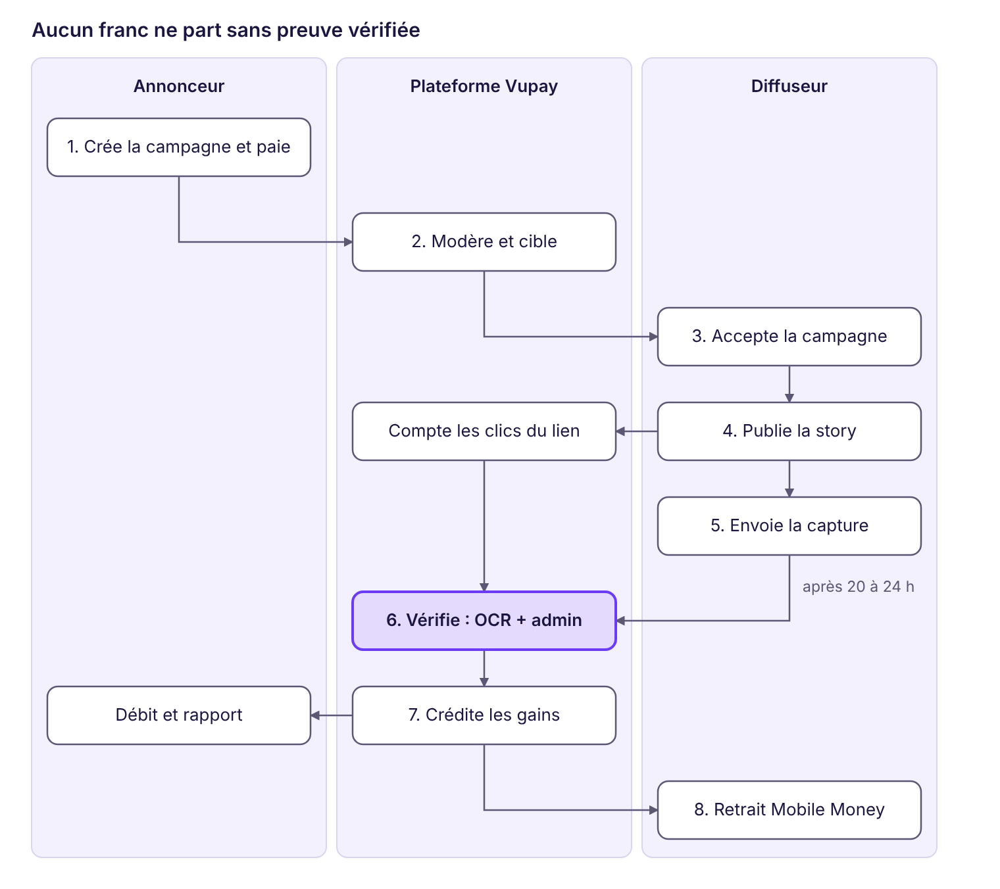

# Design — Vupay

Ressources graphiques de Vupay. Identité **propre** : aucune reprise du nom, des couleurs, du logo
ou des visuels de WhatsPay, ni des logos ou couleurs des réseaux sociaux (règle du cahier des charges).

| Dossier | Contenu | État |
| --- | --- | --- |
| `diagrammes/` | Schémas fonctionnels (SVG modifiable + PNG) | Parcours d'une campagne ✅ |
| `charte/` | Palette, typographie, ton | Palette provisoire ✅ |
| `maquettes/` | Écrans diffuseur, annonceur, admin | À faire |
| `logos/` | Logo Vupay et déclinaisons | À faire (après vérification du nom à l'OAPI) |
| `icones/` | Icônes de l'app et de la PWA | À faire |

## Visuels existants

### Parcours d'une campagne — 3 acteurs, 8 étapes

Source : cahier des charges, section « Acteurs et parcours ». Fichier modifiable : `diagrammes/parcours-campagne.svg`.

## Maquettes à produire (ordre conseillé)

1. **Diffuseur** (prioritaire, mobile) : inscription OTP, profil d'audience, liste des campagnes,
   détail et partage, envoi de la preuve, tableau de bord, retrait, vérification d'identité.
2. **Annonceur** (web) : compte entreprise, création de campagne avec ciblage et estimation, portefeuille, suivi.
3. **Admin** (web) : file des preuves, KYC, modération, retraits, paramètres.
