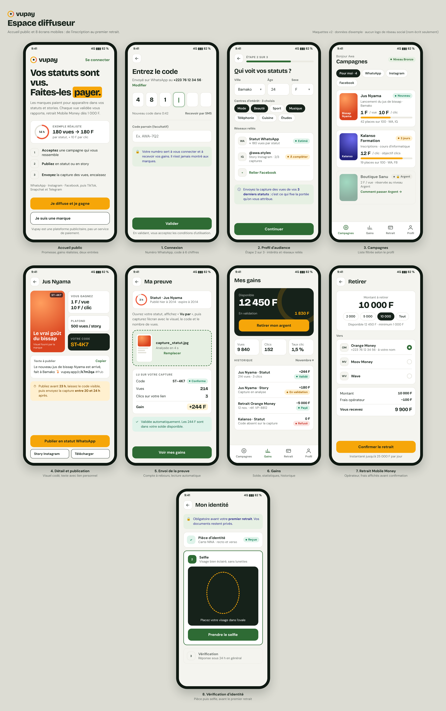
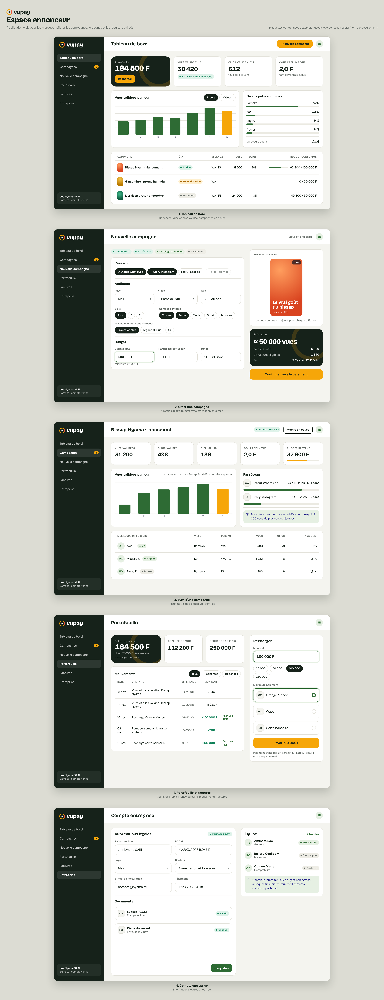

# Maquettes v3 (vert) — Vupay

**22 écrans** sur les trois espaces, avec la charte v3 : couleur de base **verte** (`design/charte/PALETTE.md`).

- **Avec les icônes 3D Bogolan** : `maquettes-bogolan.html` (les 22 écrans sur une page, plus la galerie des icônes),
  produite par `python3 design/maquettes/construire_bogolan.py`.
- **Exports PNG** : régénérés par `node design/maquettes/exporter_png.js` après tout changement de charte.
Toutes les maquettes partagent la même feuille de style : `vupay-ui.css`.
Les fichiers `.html` s'ouvrent dans un navigateur et se modifient directement ; les `.png` sont les exports.
Données d'exemple uniquement. Aucun logo de réseau social : nom écrit seulement.

## Espace diffuseur (mobile) — 9 écrans

| Écran | Contenu |
| --- | --- |
| Accueil public | Promesse, exemple de gains réaliste, 3 étapes, entrées diffuseur et marque |
| 1. Connexion | Code à 6 chiffres reçu sur WhatsApp, code parrain |
| 2. Profil d'audience | Étape 2/3 : ville, âge, sexe, intérêts, réseaux reliés et portée |
| 3. Campagnes | Gain par vue et par clic, places restantes, campagne verrouillée par niveau |
| 4. Détail et publication | Visuel avec code ST-4K7, texte avec lien et #Pub, boutons de publication |
| 5. Envoi de la preuve | Anneau de compte à rebours, capture, lecture automatique, gain |
| 6. Gains | Solde disponible et en validation, statistiques, historique |
| 7. Retrait | Montants rapides, opérateur, frais, montant reçu |
| 8. Vérification d'identité | Pièce reçue, selfie, délai de réponse |

## Espace annonceur (web) — 5 écrans

| Écran | Contenu |
| --- | --- |
| 1. Tableau de bord | Portefeuille, vues et clics validés, coût réel par vue, villes, campagnes |
| 2. Créer une campagne | Réseaux, audience, niveau minimum, budget, aperçu et estimation en direct |
| 3. Suivi d'une campagne | Résultats par jour et par réseau, captures en vérification, meilleurs diffuseurs |
| 4. Portefeuille et factures | Solde, mouvements, recharge Mobile Money ou carte |
| 5. Compte entreprise | Informations légales, documents, équipe, contenus interdits |

## Back-office administrateur (web) — 8 écrans

| Écran | Contenu |
| --- | --- |
| 1. Vue d'ensemble | Activité, marge, files à traiter, solde de décaissement par opérateur, alertes de fraude, courbe 14 jours |
| 2. File des preuves | Capture, lecture automatique, historique du diffuseur, plafond, décision |
| 3. Identités (KYC) | Pièce et selfie côte à côte, contrôles de doublons |
| 4. Modération | Créatif, ciblage, liste de contrôle des contenus |
| 5. Retraits | Demandes au-dessus du plafond, contrôles, échecs opérateur, validation groupée |
| 6. Utilisateurs | Recherche, niveau, KYC, fiabilité, note interne, sanctions |
| 7. Paramètres | Tarifs par réseau et par pays, seuils de retrait, règles anti-fraude |
| 8. Journal | Actions de l'équipe, rôle, détail, non modifiable |

## Points à valider

Charte v2 (safran / indigo / encre), logo provisoire (anneau + « vupay ») en attendant la vérification du nom,
frais de retrait affichés à titre d'exemple (décision ouverte dans `docs/DECISIONS.md`).
